# Arquitetura do agente SPED Contribuições

Revisão de referência: 2026-11-05; estado sincronizado em 2026-11-10. Referência inspecionada: solução CorporativoAI,
projetos Api.Conhecimento e Api.Atendimento. Este documento define o desenho alvo;
não declara a implementação dos componentes ainda pendentes nas tasks.

## Fluxo completo

```mermaid
flowchart LR
    P[Manuais e guias oficiais PDF] --> I[Api.RAG: Controllers e Ingestao]
    I --> E[OpenAI: embeddings dos trechos]
    E --> V[(PostgreSQL / PgVector)]
    U[Usuário e documentos] --> F[SOFIA: recepção e seleção de agentes]
    F -->|A2A JSON-RPC / contrato SOFIA 1.0| A[Api.Agente: especialista SPED]
    A --> C[ConhecimentoMcpClient]
    C -->|Streamable HTTP /mcp| T[Tools: BuscarConhecimento]
    T --> R[Rag: ConhecimentoService]
    R --> Q[OpenAI: embedding da consulta]
    Q --> V
    V -->|Trechos aplicáveis e referências| C
    C --> L[OpenAI: interpretação e parecer]
    A -->|Resultados e verificações não realizadas| L
    L --> O[Validação do JSON e das citações]
    O --> S[Resultado especializado com evidências e limitações]
    S -->|A2A Task e Artifact| Z[SOFIA: agregação e síntese]
    Z --> UF[Resposta ao usuário]
```



O provedor de IA é acessado pela API OpenAI, com credenciais externas. Embeddings e
geração de parecer são duas operações distintas, com modelos e custos próprios.
A aplicação web ChatGPT não é um serviço usado como transporte ou armazenamento.

## Serviços e responsabilidades

| Serviço deste projeto | Papel na referência | Responsabilidade |
| --- | --- | --- |
| Api.RAG | Api.Conhecimento | Receber fontes oficiais; extrair PDF; segmentar; gerar embeddings; persistir texto/vetor/proveniência; recuperar por similaridade; expor tools MCP. |
| Api.Agente | Api.Atendimento, adaptado a especialista | Receber da SOFIA solicitações/documentos SPED; validar, consultar MCP, elaborar parecer validado e devolver resultado especializado. |
| SOFIA/INFIS (externa) | Orquestradora, não implementada neste repositório | Receber a solicitação inicial do usuário, selecionar agentes, chamar A2A, preservar análises individuais e agregar a resposta. |

Api.Agente não acessa o banco interno da Api.RAG. A IA generativa não implementa os
validadores determinísticos nem decide quais versões fiscais são compatíveis. A consulta
RAG não produz parecer; fornece evidências para que Api.Agente o produza.

## Estrutura alvo da Api.RAG

```text
src/Api.RAG/
  Controllers/                 # IngestController e administração autenticada
  Ingestao/                    # IngestaoService, PdfTextExtractor, segmentadores
  Rag/                         # ConhecimentoService e OpenAiEmbeddingService
  Tools/                       # BuscarConhecimentoTool e ResolverReferenciaTool
  Domain/Knowledge/            # Versões, gerações, referências e invariantes
  Application/Knowledge/       # Casos de uso e portas já definidos
  Infrastructure/              # SQL, segurança, configuração, consumo e auditoria
  Endpoints/Contracts/         # DTOs versionados compartilhados do transporte
  Endpoints/Middleware/        # Erros e tratamento HTTP existentes
  Program.cs                  # Composição e registro MCP/Controllers
```

Controllers/Tools são adaptadores de entrada e delegam aos serviços/casos de uso.
Ingestao e Rag reproduzem a organização funcional da referência, preservando as portas
e o domínio já implementados. Não duplicar IEmbeddingProvider/IPdfTextExtractor por
mero renomeio. OpenAiEmbeddingService implementa a porta existente e é instrumentado
pelo decorator medido. ConhecimentoService coordena BuscarConhecimento e ResolverReferencia;
não contém SQL nem substitui as regras de elegibilidade do domínio.

Não é exigido mover código de segurança/persistência estável nem criar camadas/projetos
extras para copiar diretórios. Os caminhos novos se aplicam às tarefas ainda abertas.

## Ingestão e vetorização

1. POST `/api/v1/ingest`, multipart `arquivo` + `metadata`, autenticação administrativa.
2. Validar formato, limites, origem, versão e aplicabilidade; calcular hash no servidor.
3. Extrair texto por página, preservar localização e segmentar por estratégia versionada.
4. Gerar embeddings reais dos trechos usando OpenAI. Fake é exclusivo dos testes.
5. Gravar texto, vetor e proveniência em PostgreSQL/PgVector; preservar versões e gerações.
6. Ao concluir texto e vetores, publicar automaticamente a geração (ativa) e retirar da busca
   as versões anteriores da mesma fonte ([ADR 0009](../specs/001-base-fiscal-versionada/adrs/0009-simplificacao-ingestao-busca.md)).

A referência usa ingestão síncrona e resposta 201. Este projeto mantém operação durável
202 + acompanhamento, sem `Idempotency-Key`/`If-Match`: a repetição segura vem da identidade do
documento (reenvio reaproveita ou refaz a geração). Acompanhamento em `/admin/v1/operations/{id}`
e `/admin/v1/document-versions/{id}`; não há endpoints de ciclo de vida.

## Consulta semântica e MCP

O consumidor usa HttpClientTransport, McpClient.CreateAsync, ListToolsAsync e CallToolAsync,
como ConhecimentoMcpClient da referência. O servidor implementado registra handlers explícitos
em `/mcp`, limitados às duas tools aprovadas e seus schemas resolvidos. Registro por atributos
McpServerToolType/McpServerTool era uma alternativa do desenho, não foi a opção implementada.
Manter o SDK 2.3.0 já fixado até evidência justificar mudança; a referência observada usa 2.2.0.

Tool principal: `BuscarConhecimento(consulta, tipoDocumento, versaoLayout)`.
Tool auxiliar: `ResolverReferencia(referenceId)`.
O tipo/versão vem da identificação determinística do SPED, nunca de suposição do LLM.
Os dois campos adicionais adaptam a assinatura `BuscarConhecimento(consulta)` da referência;
um cliente dela precisa ser ajustado para o contexto fiscal. Não alegar compatibilidade
binária/contratual automática apenas por usar o mesmo SDK ou nome de tool.

ConhecimentoService gera o embedding da consulta com espaço compatível, executa SQL
parametrizado com operador cosseno `<=>`, filtra versão/aplicabilidade/publicação/geração/perfil,
ordena e limita resultados. Similaridade pode ser apresentada como `1 - distância`; limiar,
topK, modelo, dimensão e segmentação dependem de avaliação. Busca exata é a baseline;
HNSW é uma alternativa a medir, não uma condição comprovada pelo comentário do projeto de referência.

Resposta MCP tem structuredContent conforme Result e cópia textual JSON para clientes que
leem TextContentBlock. Não enviar somente texto livre com fonte/score, pois o parecer precisa
de IDs e referências validáveis. Falhas técnicas e ausência de evidência permanecem distintas.

## Estrutura alvo da Api.Agente

```text
src/Api.Agente/
  Controllers/AnalisesController.cs
  Analise/AnaliseSpedService.cs
  Validacao/                    # Identificação, parser e regras oficiais versionadas
  Mcp/IConhecimentoClient.cs
  Mcp/ConhecimentoMcpClient.cs
  Mcp/ConhecimentoMcpOptions.cs
  Analise/AnalysisPorts.cs       # Portas de geração/auditoria e contexto mínimo
  Llm/OpenAiParecerLlm.cs
  Contracts/                    # Requisição, envelope e JSON estrito do parecer
  Domain/                       # Invariantes próprias da análise
  Infrastructure/               # Consumo, auditoria e configuração da Api.Agente
```

Fluxo: arquivo → identificação/validações determinísticas → MCP → trechos oficiais →
modelo OpenAI → validação estrutural e semântica → parecer. O modelo interpreta os
resultados e explica inconsistências com evidências; não inventa regras, conclusões,
páginas ou referências. Saída inválida, indisponibilidade ou falta de evidência não
equivalem a conformidade. Metadados de execução/custos são preenchidos pelo sistema.

Não copiar fallback Gemini, SQL Server, atendimento genérico ou memória como fonte oficial.
Function Calling, quando necessário, segue Semantic Kernel e autorização próprios;
o controle do fluxo obrigatório não é delegado à escolha do modelo. A2A com SOFIA está
especificado na Feature 003 e ainda não implementado; memória permanece incremento separado.

## Implementação e planejamento

Histórico do incremento dos ajustes 1–4: Controllers, extração/segmentação em Ingestao, modelos e
migração 0006, fila textual durável e worker foram implementados. Rag/Tools documentam os
adaptadores seguintes, sem registrar capacidades ainda indisponíveis. Após extração,
`preparationState=ready`, operação queued/EMBEDDINGS_PENDING e publicação unpublished.
Esse estado textual foi a entrega inicial; foi estendido pelo incremento 5–11 descrito abaixo.
Na revisão do incremento, consultas administrativas passaram a delegar ao caso de uso
ConsultarIngestao, que aplica autorização própria. Transições de preparação/retomada/falha
são validadas por GeracaoProcessamento e Operacao; os adaptadores persistem o resultado.
Perfis completos são validados na inicialização com unicidade por UUID. Retomadas têm limite
externo MaxPreparationAttempts; erros técnicos não são convertidos em PDF ilegível.
Decisão e limites: [ADR 0005](../specs/001-base-fiscal-versionada/adrs/0005-ingestao-textual-incremental.md).

Incremento 5–11: a geração segue da preparação textual para embeddings, com lease próprio,
vetores persistidos por trecho e conclusão íntegra (publicada automaticamente desde a ADR 0009). SDK OpenAI real,
tentativas medidas e custos desconhecidos nulos; modelo/dimensão/segredos externos. Workers
compartilham o limite de concorrência por instância. ConhecimentoService coordena a consulta;
SQL exato/cosseno e snapshots são adaptadores internos, sem acesso direto da Api.Agente.

As duas tools MCP já estão implementadas com schemas explícitos resolvidos, JSON estruturado
e textual equivalentes. Handlers são registrados explicitamente no SDK, preservando o contrato
estrito de argumentos. O padrão alternativo por atributos não foi usado para evitar regenerar
schemas diferentes do catálogo fiscal versionado. A busca usa o perfil configurado
(`Retrieval:AdoptedProfileId` ou o único perfil), sem catálogo nem perfil adotado.
Referências históricas exigem geração efetivamente ativada; geração não concluída nunca é evidência.
Aprovação, reprocessamento/retirada administrativos, descoberta de retenção, expurgo e corte de
catálogo foram removidos pela [ADR 0009](../specs/001-base-fiscal-versionada/adrs/0009-simplificacao-ingestao-busca.md).
Decisão original: [ADR 0006](../specs/001-base-fiscal-versionada/adrs/0006-embeddings-recuperacao-ciclo-mcp.md).

- Feature 001: base fiscal e servidor MCP; T001–T018 são evidências históricas da fundação.
  T019–T084 refletem a organização e o estado dos incrementos; avaliação fiscal e capacidade oficiais permanecem pendentes.
- Feature 002: validação SPED, cliente MCP e parecer generativo. Artefatos em
  `specs/002-validacao-sped-parecer/`; implementação parcial em `src/Api.Agente`
  (parser SPED, MCP, análise estrutural, parecer condicionado aos gates e persistência própria)
  com testes em `tests/Api.Agente.Tests`.
- Referência e diferenças verificadas: [comparação](reference-api-conhecimento.md).
- Requisitos globais: [requirements.md](requirements.md).

Segredos externos, policies JWT, auditoria por tentativa, isolamento e gates P02–P04
continuam obrigatórios (P01 encerrado pela ADR 0009: sem expurgo). A adoção de uma referência
não aprova operação real.

Correções de revisão em 2026-11-10 ([ADR 0007](../specs/001-base-fiscal-versionada/adrs/0007-correcao-perfis-retencao-consumo.md)):
a parte de perfil staged/catálogo e retenção foi substituída pela ADR 0009; continua vigente a
persistência do uso conhecido mesmo quando o vetor recebido é inválido.

## Configuração local e estado da entrega

O usuário escolheu text-embedding-3-small para embeddings (1536 dimensões no exemplo local)
e gpt-4.1-mini (`OpenAI:ChatModel`) para parecer na Api.Agente. Não há gerador na Api.RAG.
Escolha de modelo não é avaliação fiscal; topK/limiar/chunk de desenvolvimento não são avaliados.

A dispensa de JWT autorizada está implementada em Development loopback,
com flag explícita e ator development-local; HTTPS/hosts continuam exigidos e metadados
OAuth retornam 404 nesse modo. Outros ambientes recusam a flag e mantêm JWT/atribuições
centrais no modo normal. Api.Agente implementa controle próprio equivalente; isso não fecha P04.
A etapa vetorial liga quando `OpenAI:ApiKey` está preenchida.
[ADR 0008](../specs/001-base-fiscal-versionada/adrs/0008-configuracao-local-modelos.md) e
[ADR 0010](../specs/001-base-fiscal-versionada/adrs/0010-ambiente-local-openai-swagger.md).
Ambiente local (Docker com pgvector e pgAdmin, scripts e Swagger): [guia](development-configuration.md).

Última evidência: 97 testes aprovados, nove migrações em PostgreSQL/PgVector descartável,
cliente MCP separado, build sem avisos/erros e formatação conferida; ingestão real local do
Guia Prático 1.35 (814 trechos). Nenhuma avaliação oficial, ensaio 300 PDFs/5 consultas,
backup/restauração ou migração em ambiente real é presumida.
[Mapa SDD](../specs/001-base-fiscal-versionada/validation/sdd-synchronization.md).

## Fronteira SOFIA → Api.Agente (desenho confirmado)

A orquestradora SOFIA/INFIS é quem recebe a requisição original e decide se a especialidade
SPED deve ser acionada. Api.Agente não encaminha pedidos a outros agentes. Sua coordenação
é interna à análise fiscal. O desenho acima é alvo para A2A e validação fiscal completa.
O código atual tem análise estrutural/parecer parametrizado, sem aceite fiscal ou produção.

SOFIA descobre /.well-known/agent-card.json e usa a url anunciada/validada para message/send.
Contrato SOFIA v1.0 em TextPart de Message; retorno em TextPart de Artifact/Task. Api.Agente
mantém seu cliente MCP, sem alteração no servidor/banco/contratos da RAG.
O recebimento atual de bytes em /api/v1/sped/leitura é REST técnico; a futura entrada A2A
recebe documentos[].texto e requer adaptação sem normalização/perda de CRLF/valores.

idExecucao/idSolicitacao/idDocumento recebidos e idAgente configurado são preservados;
executionId/correlationId locais e task/context/message IDs do A2A têm papéis distintos.
usuario.nome/contexto/pergunta não autenticam ou autorizam. SOFIA→Agente e Agente→RAG têm
credenciais e audiences próprias; modo loopback sem JWT não libera integração externa.

[Feature 003](../specs/003-integracao-sofia-a2a/spec.md),
[contrato](../specs/003-integracao-sofia-a2a/contracts/sofia-v1.md) e
[ADR](../specs/003-integracao-sofia-a2a/adrs/0001-sofia-orquestradora.md) registram desenho,
pendências e tarefas. Não houve mudança na Api.RAG ou implementação de protocolo neste ajuste.
