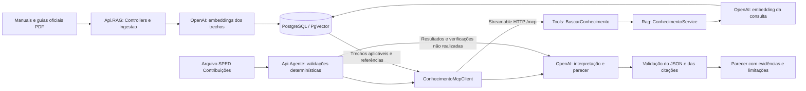

# Arquitetura do agente SPED Contribuições

Revisão documental: 2026-11-05. Referência inspecionada: solução CorporativoAI,
projetos Api.Conhecimento e Api.Atendimento. Este documento define o desenho alvo;
não declara a implementação dos componentes ainda pendentes nas tasks.

## Fluxo completo



O provedor de IA é acessado pela API OpenAI, com credenciais externas. Embeddings e
geração de parecer são duas operações distintas, com modelos e custos próprios.
A aplicação web ChatGPT não é um serviço usado como transporte ou armazenamento.

## Serviços e responsabilidades

| Serviço deste projeto | Papel na referência | Responsabilidade |
| --- | --- | --- |
| Api.RAG | Api.Conhecimento | Receber fontes oficiais; extrair PDF; segmentar; gerar embeddings; persistir texto/vetor/proveniência; recuperar por similaridade; expor tools MCP. |
| Api.Agente | Api.Atendimento | Receber SPED; executar validadores; consultar a RAG pelo cliente MCP; enviar resultados e evidências ao modelo gerador; validar e retornar o parecer. |

Api.Agente não acessa o banco interno da Api.RAG. A IA generativa não implementa os
validadores determinísticos nem decide quais versões fiscais são compatíveis. A consulta
RAG não produz parecer; fornece evidências para que Api.Agente o produza.

## Estrutura alvo da Api.RAG

```text
src/Api.RAG/
  Controllers/                 # IngestController e administração autenticada
  Ingestao/                    # IngestaoService, PdfTextExtractor, segmentadores
  Rag/                         # ConhecimentoService e OpenAiEmbeddingService
  Tools/                       # BuscarConhecimentoTool e ResolverReferenciaTool
  Domain/Knowledge/            # Versões, gerações, referências e invariantes
  Application/Knowledge/       # Casos de uso e portas já definidos
  Infrastructure/              # SQL, segurança, configuração, consumo e auditoria
  Endpoints/Contracts/         # DTOs versionados compartilhados do transporte
  Endpoints/Middleware/        # Erros e tratamento HTTP existentes
  Program.cs                  # Composição e registro MCP/Controllers
```

Controllers/Tools são adaptadores de entrada e delegam aos serviços/casos de uso.
Ingestao e Rag reproduzem a organização funcional da referência, preservando as portas
e o domínio já implementados. Não duplicar IEmbeddingProvider/IPdfTextExtractor por
mero renomeio. OpenAiEmbeddingService implementará a porta existente e será instrumentado
pelo decorator medido. ConhecimentoService coordena BuscarConhecimento e ResolverReferencia;
não contém SQL nem substitui as regras de elegibilidade do domínio.

Não é exigido mover código de segurança/persistência estável nem criar camadas/projetos
extras para copiar diretórios. Os caminhos novos se aplicam às tarefas ainda abertas.

## Ingestão e vetorização

1. POST `/api/v1/ingest`, multipart `arquivo` + `metadata`, autenticação administrativa.
2. Validar formato, limites, origem, versão e aplicabilidade; calcular hash no servidor.
3. Extrair texto por página, preservar localização e segmentar por estratégia versionada.
4. Gerar embeddings reais dos trechos usando OpenAI. Fake é exclusivo dos testes.
5. Gravar texto, vetor e proveniência em PostgreSQL/PgVector; preservar versões e gerações.
6. Concluir processamento sem publicar automaticamente; aprovação central torna a fonte elegível.

A referência usa ingestão síncrona e resposta 201. Este projeto mantém operação durável
202 + acompanhamento e aprovação, por exigência fiscal já aprovada. A mudança é de rota
planejada e organização, não de garantia de publicação. APIs de acompanhamento e ciclo de
vida permanecem sob `/admin/v1`.

## Consulta semântica e MCP

O consumidor usa HttpClientTransport, McpClient.CreateAsync, ListToolsAsync e CallToolAsync,
como ConhecimentoMcpClient da referência. O servidor registra classes com McpServerToolType
e métodos McpServerTool em `/mcp`, por registro explícito/assembly limitado às tools aprovadas.
Manter o SDK 2.3.0 já fixado até evidência justificar mudança; a referência observada usa 2.2.0.

Tool principal: `BuscarConhecimento(consulta, tipoDocumento, versaoLayout)`.
Tool auxiliar: `ResolverReferencia(referenceId)`.
O tipo/versão vem da identificação determinística do SPED, nunca de suposição do LLM.
Os dois campos adicionais adaptam a assinatura `BuscarConhecimento(consulta)` da referência;
um cliente dela precisa ser ajustado para o contexto fiscal. Não alegar compatibilidade
binária/contratual automática apenas por usar o mesmo SDK ou nome de tool.

ConhecimentoService gera o embedding da consulta com espaço compatível, executa SQL
parametrizado com operador cosseno `<=>`, filtra versão/aplicabilidade/publicação/geração/perfil,
ordena e limita resultados. Similaridade pode ser apresentada como `1 - distância`; limiar,
topK, modelo, dimensão e segmentação dependem de avaliação. Busca exata é a baseline;
HNSW é uma alternativa a medir, não uma condição comprovada pelo comentário do projeto de referência.

Resposta MCP tem structuredContent conforme Result e cópia textual JSON para clientes que
leem TextContentBlock. Não enviar somente texto livre com fonte/score, pois o parecer precisa
de IDs e referências validáveis. Falhas técnicas e ausência de evidência permanecem distintas.

## Estrutura alvo da Api.Agente

```text
src/Api.Agente/
  Controllers/AnalisesController.cs
  Analise/AnaliseSpedService.cs
  Validacao/                    # Identificação, parser e regras oficiais versionadas
  Mcp/IConhecimentoClient.cs
  Mcp/ConhecimentoMcpClient.cs
  Mcp/ConhecimentoMcpOptions.cs
  Llm/IParecerLlm.cs
  Llm/OpenAiParecerLlm.cs
  Contracts/                    # Requisição, envelope e JSON estrito do parecer
  Domain/                       # Invariantes próprias da análise
  Infrastructure/               # Consumo, auditoria e configuração da Api.Agente
```

Fluxo: arquivo → identificação/validações determinísticas → MCP → trechos oficiais →
modelo OpenAI → validação estrutural e semântica → parecer. O modelo interpreta os
resultados e explica inconsistências com evidências; não inventa regras, conclusões,
páginas ou referências. Saída inválida, indisponibilidade ou falta de evidência não
equivalem a conformidade. Metadados de execução/custos são preenchidos pelo sistema.

Não copiar fallback Gemini, SQL Server, atendimento genérico ou memória como fonte oficial.
Function Calling, quando necessário, segue Semantic Kernel e autorização próprios;
o controle do fluxo obrigatório não é delegado à escolha do modelo. A2A e memória
conversacional permanecem incrementos separados, sem impedir a integração MCP inicial.

## Implementação e planejamento

Incremento dos ajustes 1–4: Controllers, extração/segmentação em Ingestao, modelos e
migração 0006, fila textual durável e worker foram implementados. Rag/Tools documentam os
adaptadores seguintes, sem registrar capacidades ainda indisponíveis. Após extração,
`preparationState=ready`, operação queued/EMBEDDINGS_PENDING e publicação unpublished.
O fluxo completo acima continua sendo o alvo; embeddings, busca e aprovação ainda estão pendentes.
Na revisão do incremento, consultas administrativas passaram a delegar ao caso de uso
ConsultarIngestao, que aplica autorização própria. Transições de preparação/retomada/falha
são validadas por GeracaoProcessamento e Operacao; os adaptadores persistem o resultado.
Perfis completos são validados na inicialização com unicidade por UUID. Retomadas têm limite
externo MaxPreparationAttempts; erros técnicos não são convertidos em PDF ilegível.
Decisão e limites: [ADR 0005](../specs/001-base-fiscal-versionada/adrs/0005-ingestao-textual-incremental.md).

- Feature 001: base fiscal e servidor MCP; T001–T018 são evidências históricas da fundação.
  T019–T084 refletem a nova organização; as duas tools ainda não foram implementadas.
- Feature 002: validação SPED, cliente MCP e parecer generativo. Artefatos em
  `specs/002-validacao-sped-parecer/`, sem código criado nesta revisão.
- Referência e diferenças verificadas: [comparação](reference-api-conhecimento.md).
- Requisitos globais: [requirements.md](requirements.md).

Segredos externos, policies JWT, auditoria por tentativa, retenção, isolamento e gates
P01–P04 continuam obrigatórios. A adoção de uma referência não aprova operação real.
